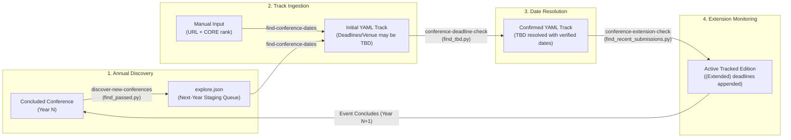

# Auto Agents: Conference Intelligence Skills for Antigravity

A curated repository of [Google Antigravity](https://github.com/google/antigravity) agent skills, automation scripts, and workflows designed for discovering, tracking, and maintaining academic conference deadlines.

Originally developed for the **KhongSoMeo (KSM)** conference tracker ecosystem (e.g., [`ai-deadlines`](https://github.com/)), this repository serves as a centralized hub to store, maintain, and reuse conference intelligence skills across multiple projects and agent workflows.

---

## 📂 Repository Structure

```text
auto-agents/
├── README.md                                # Repository documentation
└── antigravity/
    └── skills/
        ├── find-conference-dates/           # Ingests conference metadata and generates track YAMLs
        │   ├── SKILL.md                     # Skill instructions & constraints
        │   ├── examples/
        │   │   └── example.yml              # Canonical YAML schema example
        │   └── resources/
        │       ├── available_tags.json      # Whitelist of standardized topic tags
        │       └── explore.json             # Discovery staging queue
        │
        ├── conference-deadline-check/       # Resolves missing or TBD dates
        │   ├── SKILL.md
        │   └── scripts/
        │       └── find_tbd.py              # CLI helper to scan for TBD entries
        │
        ├── conference-extension-check/      # Detects and records deadline extensions
        │   ├── SKILL.md
        │   └── scripts/
        │       └── find_recent_submissions.py # Scans for deadlines within a ±14 day window
        │
        └── discover-new-conferences/        # Discovers next year's conference websites
            ├── SKILL.md
            └── scripts/
                ├── find_passed.py           # Finds fully concluded conferences
                └── run_discover.py          # Probes predicted URLs and stages to explore.json
```

---

## ⚡ Available Skills Catalog

| Skill | Description | Primary Inputs | Helper Script |
|---|---|---|---|
| [`find-conference-dates`](antigravity/skills/find-conference-dates/SKILL.md) | Scrapes official sites, fetches CORE ranking, maps standardized tags, and creates formatted conference YAML track files. | Direct inputs (URL, short name, CORE link) or batch from `explore.json` | — |
| [`conference-deadline-check`](antigravity/skills/conference-deadline-check/SKILL.md) | Identifies conferences with `TBD` submission deadlines or event dates, scrapes official portals, and updates missing fields. | Workspace path with `src/data/conferences/` | [`find_tbd.py`](antigravity/skills/conference-deadline-check/scripts/find_tbd.py) |
| [`conference-extension-check`](antigravity/skills/conference-extension-check/SKILL.md) | Detects deadline extensions for paper/abstract submissions approaching soon or recently passed, appending `(Extended)` entries. | Workspace path with `src/data/conferences/` | [`find_recent_submissions.py`](antigravity/skills/conference-extension-check/scripts/find_recent_submissions.py) |
| [`discover-new-conferences`](antigravity/skills/discover-new-conferences/SKILL.md) | Predicts next year's URLs for concluded conferences, tests connectivity, and stages live sites into `explore.json`. | Workspace path with `src/data/conferences/` | [`find_passed.py`](antigravity/skills/discover-new-conferences/scripts/find_passed.py), [`run_discover.py`](antigravity/skills/discover-new-conferences/scripts/run_discover.py) |

---

## 🔄 Conference Tracking Lifecycle

The skills coordinate to maintain a comprehensive and up-to-date conference database:



---

## 🚀 Setup & Reusing Skills

To utilize these skills in any target conference repository (e.g., `ai-deadlines`):

### Option A: Symlink Skills (Recommended for Active Development)
Symlinking ensures any updates or improvements made to skills in this repository are immediately active in your working tracker:
```bash
# From within your target repository root:
mkdir -p .agent/skills
ln -s /path/to/auto-agents/antigravity/skills/* .agent/skills/
```

### Option B: Copy Skills Directly
```bash
mkdir -p .agent/skills
cp -r /path/to/auto-agents/antigravity/skills/* .agent/skills/
```

### Option C: User-Global Installation
To make these skills globally discoverable across all Antigravity workspaces:
```bash
mkdir -p ~/.gemini/config/skills/
cp -r /path/to/auto-agents/antigravity/skills/* ~/.gemini/config/skills/
```

---

## 💬 Triggering Skills (Agent Prompts)

Once the skills are available in the workspace or global path, you can invoke them directly in Antigravity chat:

* **Add a new conference:**
  > "Use find-conference-dates to add ACL 2027. Website: https://2027.aclweb.org, CORE ranking: https://portal.core.edu.au/conf-ranks/1234/"

* **Process staged batch discoveries:**
  > "Process all conferences pending in explore.json using find-conference-dates."

* **Check and resolve TBD dates:**
  > "Run conference-deadline-check to find and resolve any TBD dates in src/data/conferences."

* **Check for deadline extensions:**
  > "Run conference-extension-check to see if any recent or upcoming paper submission deadlines have been extended."

* **Discover next-year conference editions:**
  > "Run discover-new-conferences to find upcoming websites for concluded conferences and add them to explore.json."

---

## 🛠️ CLI Helper Scripts

Each auxiliary Python script can also be executed independently from the command line:

```bash
# 1. Scan for TBD deadlines in upcoming conferences (>= 2026):
python3 antigravity/skills/conference-deadline-check/scripts/find_tbd.py /path/to/ai-deadlines

# 2. Check for paper/abstract deadlines within a ±14 day window:
python3 antigravity/skills/conference-extension-check/scripts/find_recent_submissions.py /path/to/ai-deadlines \
    --days-past 14 \
    --days-future 14

# 3. Find conferences whose deadlines and conference dates have completely passed:
python3 antigravity/skills/discover-new-conferences/scripts/find_passed.py /path/to/ai-deadlines
```

### Python Dependencies
* Python 3.8+
* `PyYAML`
* `requests`

```bash
pip install pyyaml requests
```

---

## ➕ Adding New Skills

When adding a new conference-related skill to this repository:
1. Create a subfolder under `antigravity/skills/<skill-name>/`.
2. Add a `SKILL.md` file featuring standard YAML frontmatter (`name`, `description`) and comprehensive operating guidelines.
3. Place executable Python scripts into `scripts/` and taxonomy lists/templates into `resources/` or `examples/`.
4. Register the new skill in the [Available Skills Catalog](#-available-skills-catalog) above.
